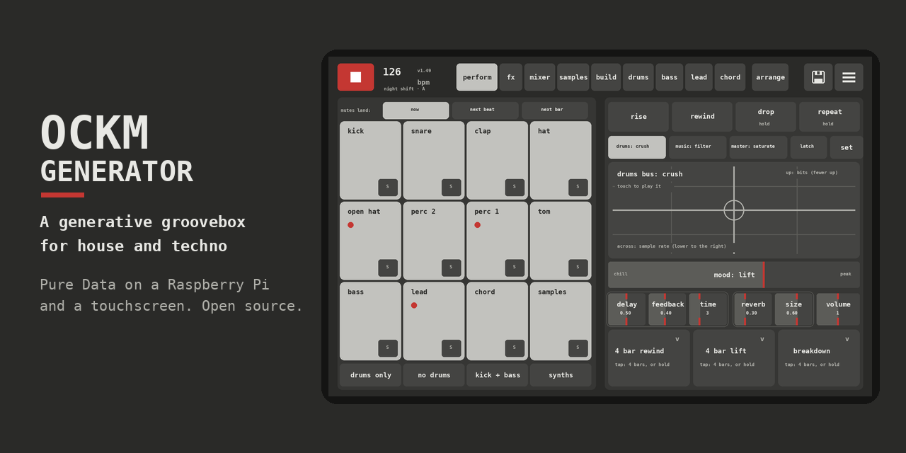
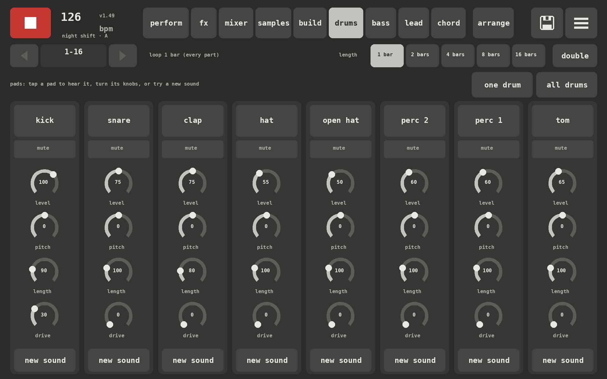
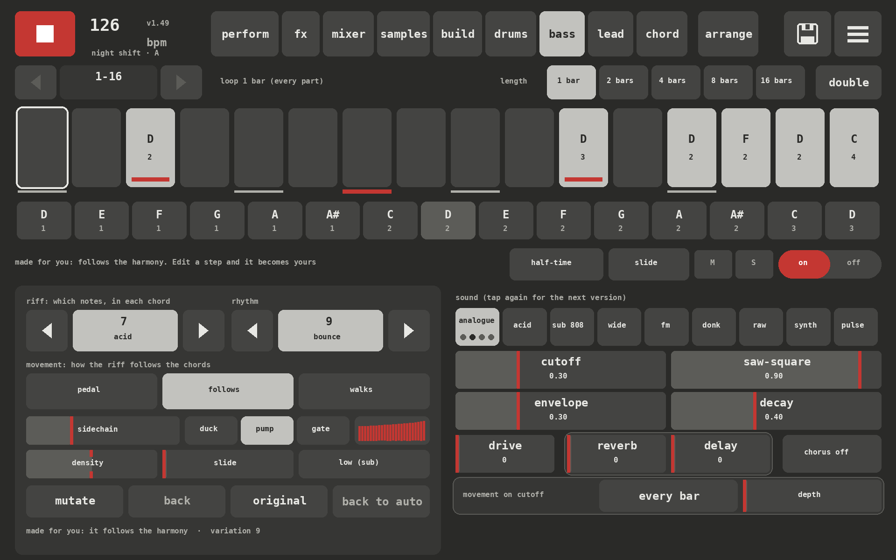
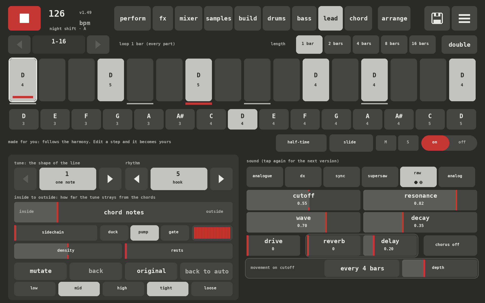
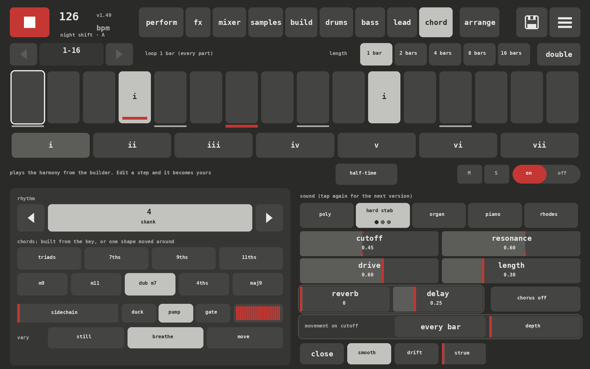
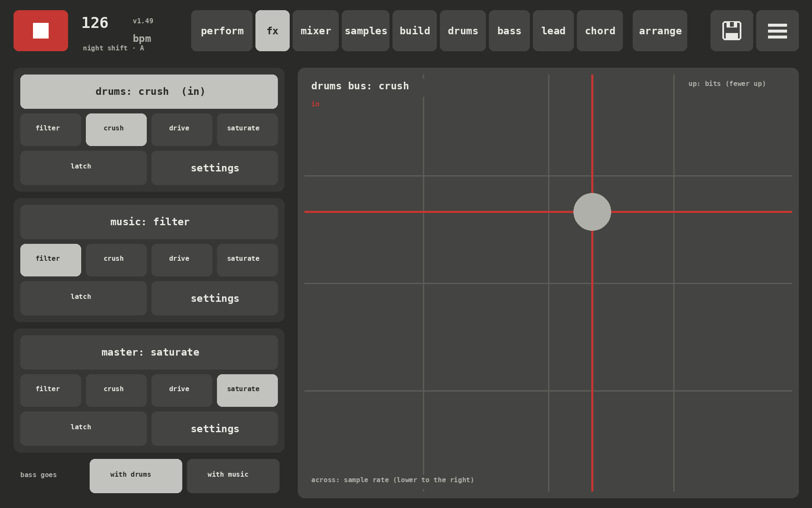

<p align="center"></p>

# OCKM GENERATOR

**A generative groovebox for house and techno.** A drum machine, a bass synth, a lead synth and a chord synth in one box, built in Pure Data and played on a touchscreen. It runs on a Raspberry Pi 5 with the 10-inch Touch Display, and on a Mac or PC in plugdata.

Tap a style and it builds a whole loop in that style: tempo, groove, key, chords, bassline, lead, sounds and mix. Then it's yours. Mute, solo, push the mood up, drop the drums out for four bars and rewind into the drop. Edit any step by hand, save scenes, arrange them into a track and export it.

It helps, but it never takes over. Everything it makes, you can change.


## Play it

**Perform** is where you spend the night. Twelve tiles mute and bring back each drum and each part, landing on the beat or the bar. **Rise**, **rewind**, **drop** and **repeat** are one tap each. The **mood** dial takes the whole loop from chill to peak: busier hats, more notes, more slides, drier and harder as it climbs. Six recipe pads play moves that last a few bars, like the **4 bar rewind**: the drums drop out, the high-pass climbs, and on the last beat the mix spins back like a record and stops right on the 1.

The fx pad plays three bus effects (drums, music, master) with one finger: filter, crush, drive or saturate.

| Drums | Pads |
|---|---|
|  |  |

## Build it

The **builder** sets what every part follows: fifteen styles from deep house and Chicago through Italo piano, nu disco and trance to peak time and hard techno. Every tap is a fresh take inside the style, and "classic" is the canonical one. Key, scale and progression are shared by every part. Phrases, turnarounds and fills shape the bigger picture, and **evolve** changes one part every phrase and brings it back.


## The sounds

**Drums:** eight slots, every one synthesised from scratch in Pd. Each drum also comes as **808**, **909** and **909 long**, built from the same synth voices, so it sounds right with no samples at all. Add your own samples whenever you like: see [samples/README.md](samples/README.md).

**Bass and lead:** mono synths with their own engines: analogue, acid, sub 808, wide, FM, donk, raw and pulse for the bass; analogue, DX, sync, supersaw and raw for the lead. Tap an engine again for its next version. Every engine and version is levelled by measurement, so swapping sounds never jumps the mix. The lines are written for you, following the chords, with mutate, density and slides. Edit any step and it becomes yours.

**Chords:** poly, hard stab, organ, house piano and Rhodes, with progressions, voicings, strum, push and drift. The piano, organ and Rhodes can play with two hands.

| Bass | Lead | Chords |
|---|---|---|
|  |  |  |

## Mix it

A **mixer** with dB faders, sends, mute, solo and a four-band EQ on every track. A drum bus with punch. Reverb, a tempo-synced delay and a master that keeps it all in check.

| Mixer | FX |
|---|---|
|  |  |

## And the rest

- **Scenes and versions:** every save is a scene. Arrange scenes into a version with a transition on each join (rise, lifts, breakdown, echo out, gap) and play it start to finish
- **Export:** the mix, stems (drums, bass, lead, chords, effects) and MIDI
- **USB audio:** on the Pi, plug a computer into the USB-C port and the box is a 9-channel audio interface: the mix, the kick, the rest of the drums, and each part on its own channel, straight into Ableton or any DAW
- **MIDI:** learn any USB controller (a knob or pad stays with its job on every screen), play the bass and lead from a keyboard, and send MIDI clock in and out
- **The show page:** a full-screen view for when the box is on display: the circle of fifths with the key lit up and the chord as a shape, and the drums flashing in the middle
- **Safe saving:** a power cut mid-save leaves you with the last good copy

## Running it

**Mac or PC:** install [plugdata](https://plugdata.org) (it has Lua built in) and open `OCKM_GENERATOR.pd`. Keep the folder together. If taps do nothing, the patch is in edit mode: Cmd+E (Ctrl+E). Vanilla Pure Data works too, with the [pd-lua](https://github.com/agraef/pd-lua) external. Windows and Linux should work the same way, but haven't been tried yet.

**Raspberry Pi 5:** Raspberry Pi OS (64-bit), then:

```
sudo apt install puredata pd-lua lua5.4
python3 tools/build.py --ui-scale 2
```

The scripts in `tools/pi/` start it full screen at boot, with touch, USB MIDI and USB audio. The [manual](docs/manual.md#on-the-pi) has the details.

| Part | What I use |
|---|---|
| Computer | Raspberry Pi 5, 4 GB, with the Active Cooler |
| Screen | Raspberry Pi Touch Display 2, 10" |
| Audio | Raspberry Pi DAC Pro (the Pi 5 has no audio socket) |
| Power and USB audio | a USB-C power and data splitter |
| Controller | any USB MIDI controller; tested with an Akai MPK mini 3 |

**Your own drum samples** are optional: [samples/README.md](samples/README.md) shows how to add them, make a kit, and copy them to the Pi.

## How it's made

The `.pd` patches are **generated**: `tools/build.py` writes every one of them, so don't edit them in Pd. The screens are Lua (`ui/ockm-ui.pd_lua`), drawn with pd-lua, and work with mouse or touch. The musical decisions (bass lines, chords, drum lanes, the mood) are Lua too, tested in plain Lua. To change anything, edit the builder or the Lua and rebuild:

```
python3 tools/build.py
python3 tests/run_tests.py       # plays the patch headless and checks it (needs vanilla pd and pd-lua)
python3 tests/ui_review.py out   # draws every screen as the Pi does and checks nothing overlaps
python3 tools/screenshots.py     # the screenshots on this page
```

The [manual](docs/manual.md) covers every screen, engine and hook. [CONTRIBUTING.md](CONTRIBUTING.md) has the ground rules.

This project was built with Claude, Anthropic's AI model, as a coding partner. I direct it, test it and play it; Claude writes most of the code. The commits credit it as co-author.

## Thanks

- [PERF-1](https://github.com/deamonSLINKY/PERF-1), a generative firmware for the FM-1, for the ideas behind the mood, the synth 808 and 909 kits, and more on the way. Go and look: it's lovely
- [Pure Data](https://puredata.info), [pd-lua](https://github.com/agraef/pd-lua) and [plugdata](https://plugdata.org), which make all of this possible

## Get involved

Help would be great with:

- **Sound design in Pd:** better engines, a stereo mix, more drum voices
- **Music:** styles, grooves, progressions and riffs that sound like the real thing
- **Controllers:** grid controllers (APC mini, Launchpad) as a step grid
- **Ports:** an iPad version
- **Playing it:** on your own hardware, and telling me what breaks or sounds wrong

Open an issue to say hello or pick something up.

## Licence

GPL-3.0. See [LICENSE](LICENSE).
