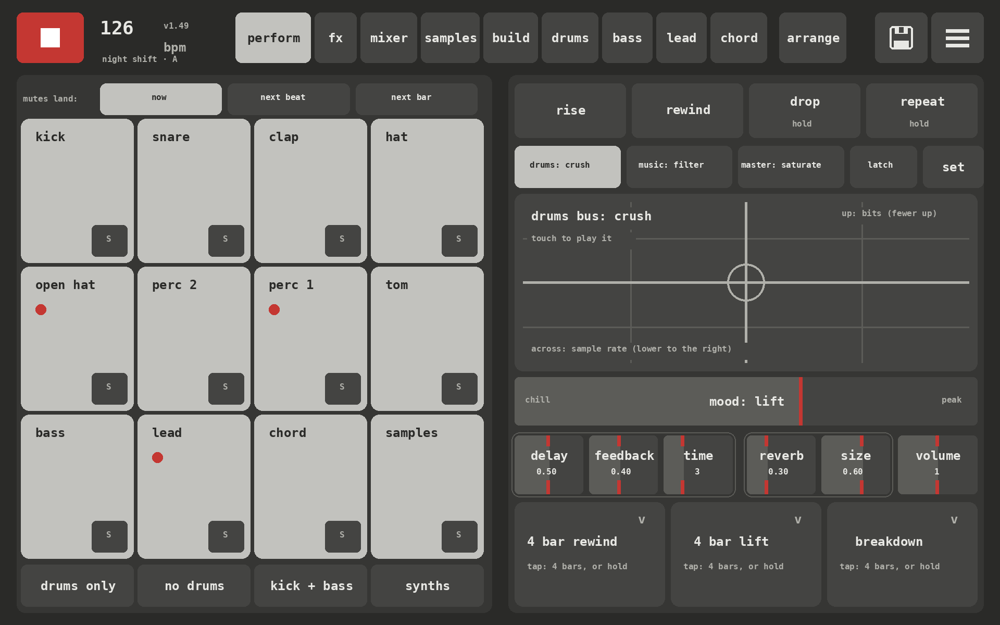
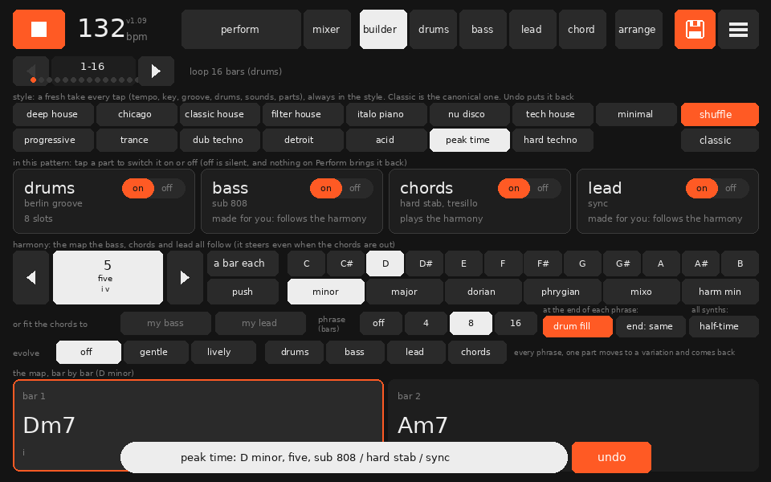
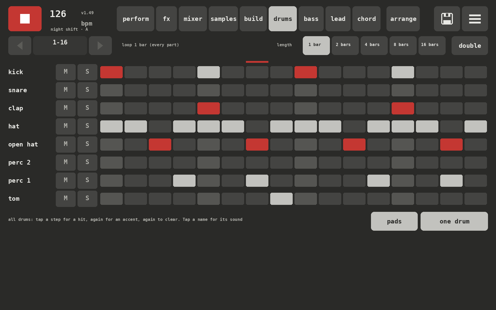
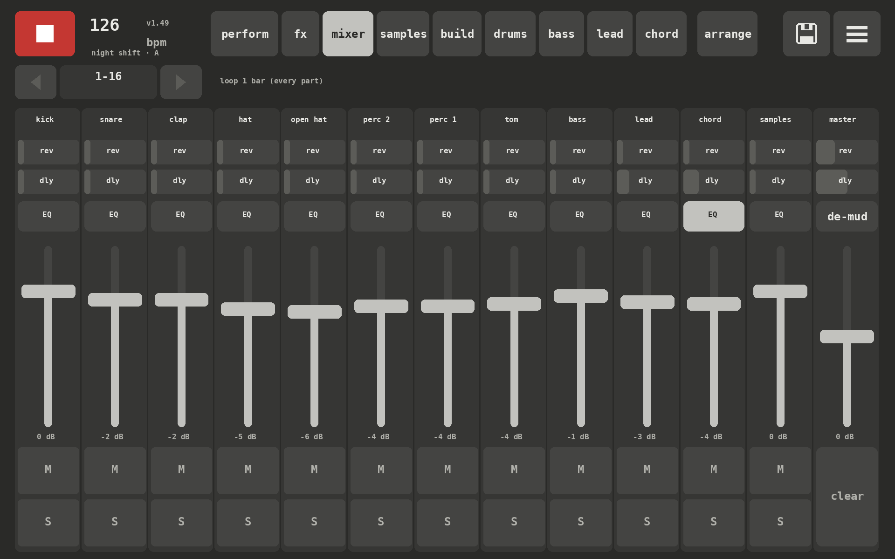

# OCKM_GNR8R

A groovebox for house and techno: a drum machine plus bass, lead and chord synths in one box, built in Pure Data and played on a touchscreen. It runs on a Raspberry Pi 5 with the 10" Touch Display, and on a Mac or PC in plugdata.

Tap a style and it builds a whole loop in that style: tempo, groove, key, chords, bassline, lead, sounds and mix. Then it's yours to change, mute, perform and export. It helps, but it never takes over: everything it makes you can edit by hand.



**Status:** v1.20, a personal project that works and gets played, moving fast. I'm looking for collaborators (see [below](#looking-for-collaborators)).

## What's in it

- **Drums:** 8 slots, each a synthesised drum (kick, snare, clap, hats, toms, rim, conga, shaker, all built from scratch in Pd) or your own samples. Per-step accents, velocity, timing, swing, and a closed hat that chokes the open one. Two banks of grooves (house and techno) fill all 8 slots in one tap. A separate drum lab designs kits and renders them to samples
- **Bass and lead:** mono synths with their own engines: analogue, acid, sub 808, FM, reese, donk and an MS-20 style raw engine for the bass; analogue, DX, sync, supersaw and raw for the lead. Rhythms and riffs are generated to follow the harmony, with mutate, density, rests and "answer the bass"
- **Chords:** poly, hard stab, organ, house piano and Rhodes engines, with progressions, voicings, strum, push and drift. Piano, organ and Rhodes can play with two hands: a left hand on the root in five patterns
- **The builder:** key, scale and progression shared by every part, phrase length, turnarounds, and an evolve setting that changes one part every phrase and brings it back
- **Fifteen styles,** from deep house and Chicago through Italo piano, filter house and trance to peak time and hard techno. Every tap is a fresh take inside the style
- **Perform:** mutes that land on the beat or bar, solos, a DJ filter, drive, rise, drop, a DJ rewind, beat repeat, and macros (8 bar lift, 4 bar lift, breakdown) that combine mutes and effects over 4 bars
- **Mixer:** dB faders, sends, mute and solo, and a 4-band EQ per track
- **Arrange and export:** turn the loop into a track; export the mix, stems and MIDI
- **MIDI:** USB controllers (pads mute and fire macros, knobs move the effects and the synth you're on), and MIDI clock in and out

| Builder | Drums | Mixer |
|---|---|---|
|  |  |  |

## Running it

**Mac:** install [plugdata](https://plugdata.org) (it has Lua built in) and open `OCKM_GENERATOR.pd`. Windows and Linux should work the same way, but haven't been tried yet. Keep the folder together. If clicks do nothing, the patch is in edit mode: Cmd+E (Ctrl+E).

Vanilla Pure Data works too, with the [pd-lua](https://github.com/agraef/pd-lua) external installed.

**Raspberry Pi 5:** Raspberry Pi OS (64-bit) with `sudo apt install puredata pd-lua lua5.4`, then build at double size for the 10" screen:

```
python3 tools/build.py --ui-scale 2
```

The scripts in `tools/pi/` start it full screen at boot, with touch and USB MIDI. The [manual](docs/manual.md#on-the-pi) has the details.

| Part | What I use |
|---|---|
| Computer | Raspberry Pi 5, 4 GB, with the Active Cooler |
| Screen | Raspberry Pi Touch Display 2, 10" |
| Audio | Raspberry Pi DAC Pro (the Pi 5 has no audio socket) |
| Controller | Any USB MIDI controller; tested with an Akai MPK mini 3 |

**Your own drum samples** go in `samples/<sound>/` (kick, snare, clap, perc, hat, open-hat, tom). They aren't in the repo.

## How it's made

The `.pd` patches are **generated**: `tools/build.py` writes every one of them. The screens are Lua (`ui/ockm-ui.pd_lua`), drawn with pd-lua, and work with mouse or touch. To change anything structural, edit the builder or the Lua and rebuild:

```
python3 tools/build.py
python3 tests/run_tests.py      # plays the patch headless and checks it (needs vanilla pd and pd-lua)
python3 tests/ui_preview.py out # draws every screen to PNGs without Pd (needs lua and Pillow)
```

The [manual](docs/manual.md) covers every screen, engine and internal hook. [CONTRIBUTING.md](CONTRIBUTING.md) has the ground rules.

This project was built with Claude, Anthropic's AI model, as a coding partner. I direct it, test it and play it; Claude writes most of the code. The commits credit it as co-author.

## Looking for collaborators

Help would be great with:

- **Sound design in Pd:** better engines, a stereo mix and bus glue, more drum voices
- **Music:** styles, grooves, progressions and riffs that sound like the real thing
- **Controllers:** MIDI learn, and grid controllers (APC mini, Launchpad) as a step grid
- **Ports:** an iPad version
- **Playing it:** on your own hardware, and telling me what breaks or sounds wrong

Open an issue to say hello or pick something up.

## Licence

GPL-3.0. See [LICENSE](LICENSE).
