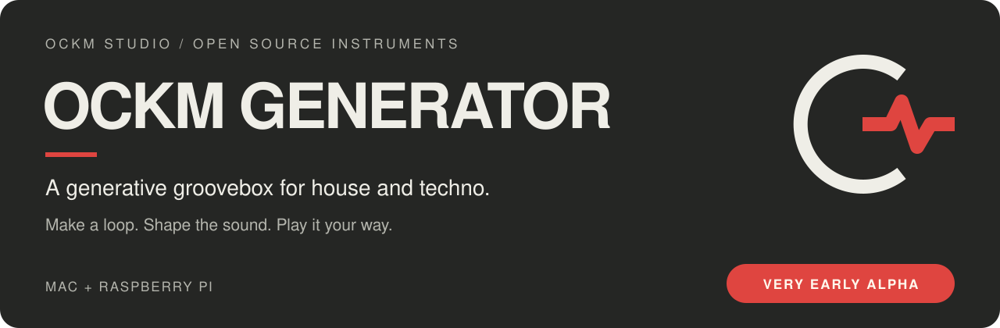

<p align="center"></p>

# OCKM GENERATOR

**A generative groovebox for house and techno.** Drums, bass, lead and chords that make a loop together, with hands-on controls to turn it into your own music. One shared Pure Data/Lua instrument, with a standalone Swift Mac app and a Raspberry Pi touchscreen version.

> [!WARNING]
> **Very, very early alpha.** This is an experiment being shared while it is still taking shape. Expect bugs, rough edges and changes to controls, sounds and file formats. Crashes, audio glitches and lost work are possible. Keep backups of anything you care about, start with your volume low, and do not rely on it for a live show or critical session yet.

[**Download Mac alpha 0.1.1**](https://github.com/OCKM-STUDIO/OCKM_GENERATOR/releases/tag/mac-preview-0.1.1) · [**Manual**](docs/manual.md) · [**Report a bug**](https://github.com/OCKM-STUDIO/OCKM_GENERATOR/issues/new/choose) · [**Contribute**](CONTRIBUTING.md)

## Start here

| Platform | How to try it | Current status |
|---|---|---|
| **Mac app** | [Download the Apple silicon ZIP](https://github.com/OCKM-STUDIO/OCKM_GENERATOR/releases/tag/mac-preview-0.1.1), unzip and open the app. [Mac guide](mac/README.md) | macOS 13+. Tested on one development Mac. Locally signed, **not notarised**; macOS may block the downloaded app. Intel is untested. |
| **Raspberry Pi 5** | [Pi setup in the manual](docs/manual.md#on-the-pi) | Touchscreen hardware project; requires setup, audio hardware and testing on your own system. |
| **plugdata / Pure Data** | [Run the shared patch](#running-it) | Desktop route for experimenting with the engine. Windows and Linux desktop use are untested. |

No sample packs are required: the drum and synth voices are generated by the instrument. The Mac download includes its engine; you do not need to install Pure Data or plugdata.

## From a loop to a performance

Tap a style and it builds a whole loop in that style: tempo, groove, key, chords, bassline, lead, sounds and mix. Then it's yours. Mute, solo, push the mood up, drop the drums out for four bars and rewind into the drop. Edit any step by hand, save scenes, arrange them into a track and export it.

It helps, but it never takes over. Everything it makes, you can change.


## Play it

**Perform** is where you spend the night. Twelve tiles mute and bring back each drum and each part, landing on the beat or the bar. **Rise**, **rewind**, **drop** and **repeat** are one tap each. The **mood** dial takes the whole loop from chill to peak: busier hats, more notes, more slides, drier and harder as it climbs. Six recipe pads play moves that last a few bars, like the **4 bar rewind**: the drums drop out, the high-pass climbs, and on the last beat the mix spins back like a record and stops right on the 1.

The fx pad plays three bus effects (drums, music, master) with one finger: filter, crush, drive or saturate.

| Drums | Pads |
|---|---|
|  |  |

## Build it

The **builder** sets what every part follows: fifteen styles from deep house and Chicago through Italo piano, nu disco and trance to peak time and hard techno. Every tap is a fresh take inside the style, and "classic" is the canonical one. Key, scale and progression are shared by every part. Phrases, turnarounds and fills shape the bigger picture, and **evolve** changes one part every phrase and brings it back.


## The sounds

**Drums:** eight slots, every one synthesised from scratch in Pd. Each drum also comes as **808**, **909** and **909 long**, built from the same synth voices, so it sounds right with no samples at all. Add your own samples whenever you like: see [samples/README.md](samples/README.md).

**Bass and lead:** mono synths with their own engines: analogue, acid, sub 808, wide, FM, donk, raw and pulse for the bass; analogue, DX, sync, supersaw and raw for the lead. Tap an engine again for its next version. Engines and versions are levelled by measurement to reduce jumps when swapping sounds. The lines are written for you, following the chords, with mutate, density and slides. Edit any step and it becomes yours.

**Chords:** poly, hard stab, organ, house piano and Rhodes, with progressions, voicings, strum, push and drift. The piano, organ and Rhodes can play with two hands.

| Bass | Lead | Chords |
|---|---|---|
|  |  |  |

## Mix it

A **mixer** with dB faders, sends, mute, solo and a four-band EQ on every track. A drum bus with punch. Reverb, a tempo-synced delay and a master that keeps it all in check.

| Mixer | FX |
|---|---|
|  |  |

## And the rest

- **Scenes and versions:** every save is a scene. Arrange scenes into a version with a transition on each join (rise, lifts, breakdown, echo out, gap) and play it start to finish
- **Export:** the mix, stems (drums, bass, lead, chords, effects) and MIDI
- **USB audio:** on the Pi, plug a computer into the USB-C port and the box is a 9-channel audio interface: the mix, the kick, the rest of the drums, and each part on its own channel, straight into Ableton or any DAW
- **MIDI:** learn any USB controller (a knob or pad stays with its job on every screen), play the bass and lead from a keyboard, and send MIDI clock in and out
- **The show page:** a full-screen view for when the box is on display: the circle of fifths with the key lit up and the chord as a shape, and the drums flashing in the middle
- **Recovery:** saves use a temporary file before replacing the previous copy, and unsaved edits have a recovery stash. Keep separate backups while the project is in alpha

## Native Mac app (early alpha)

A standalone Swift app now lives in [`mac/`](mac/README.md). It embeds the same
sound engine, generators and screen behaviour as the Pi, with a native Mac
renderer, MIDI device selection, keyboard performance controls and its own icon.
Players do not need to install plugdata or Pure Data.

Build with `python3 mac/scripts/build.py`, then open
`mac/dist/OCKM GENERATOR.app`. See the [Mac guide](mac/README.md) for requirements,
shortcuts, project locations and the current preview limitations.

## Running it

**Mac or PC:** install [plugdata](https://plugdata.org) (it has Lua built in) and open `OCKM_GENERATOR.pd`. Keep the folder together. If taps do nothing, the patch is in edit mode: Cmd+E (Ctrl+E). Vanilla Pure Data works too, with the [pd-lua](https://github.com/agraef/pd-lua) external. Windows and Linux should work the same way, but haven't been tried yet.

**Raspberry Pi 5:** Raspberry Pi OS (64-bit), then:

```
sudo apt install puredata pd-lua lua5.4
python3 tools/build.py --ui-scale 2
```

The scripts in `tools/pi/` start it full screen at boot, with touch, USB MIDI and USB audio. The [manual](docs/manual.md#on-the-pi) has the details.

| Part | What I use |
|---|---|
| Computer | Raspberry Pi 5, 4 GB, with the Active Cooler |
| Screen | Raspberry Pi Touch Display 2, 10" |
| Audio | Raspberry Pi DAC Pro (the Pi 5 has no audio socket) |
| Power and USB audio | a USB-C power and data splitter |
| Controller | any USB MIDI controller; tested with an Akai MPK mini 3 |

**Your own drum samples** are optional: [samples/README.md](samples/README.md) shows how to add them, make a kit, and copy them to the Pi.

## How it's made

The `.pd` patches are **generated**: `tools/build.py` writes every one of them, so don't edit them in Pd. The screens are Lua (`ui/ockm-ui.pd_lua`), drawn with pd-lua, and work with mouse or touch. The musical decisions (bass lines, chords, drum lanes, the mood) are Lua too, tested in plain Lua. To change anything, edit the builder or the Lua and rebuild:

```
python3 tools/build.py
python3 tests/run_tests.py       # plays the patch headless and checks it (needs vanilla pd and pd-lua)
python3 tests/ui_review.py out   # draws every screen as the Pi does and checks nothing overlaps
python3 tools/screenshots.py     # the screenshots on this page
```

The [manual](docs/manual.md) covers every screen, engine and hook. [CONTRIBUTING.md](CONTRIBUTING.md) has the ground rules.

This project is developed with AI coding assistance from Claude and OpenAI Codex. Simon directs the instrument, tests it and plays it. The shared engine grew with Claude; the native Mac host and repository work also use Codex. Human review, listening and real hardware testing remain essential.

## A tip of the hat to PERF-1

A big thank you to **[deamonSLINKY](https://github.com/deamonSLINKY)** and **[PERF-1](https://github.com/deamonSLINKY/PERF-1)**, the live-performance firmware for the M-VAVE FM-1. Its approach to generative music you can steer and play has been a major inspiration for OCKM.

That influence runs through the mood control, synthesised 808/909-style kits, call-and-answer phrases, drum probability and drift, and the build-and-drop performance moves. The [changelog](CHANGELOG.md#v149-30-october-2026) and source comments credit those ideas where they entered this project.

PERF-1 deserves a visit in its own right: **[try its browser instrument and explore the project](https://deamonslinky.github.io/PERF-1/)**. Thank you for sharing the work and the ideas so openly.

OCKM is a separate project by OCKM STUDIO; this acknowledgement does not imply involvement or endorsement by PERF-1's author.

## Built with

[Pure Data](https://puredata.info), [libpd](https://github.com/libpd/libpd), [pd-lua](https://github.com/agraef/pd-lua), [Lua](https://www.lua.org) and [plugdata](https://plugdata.org) make this possible. The Mac app adds SwiftUI, AppKit, Core Audio and CoreMIDI. Bundled dependency notices and pinned source revisions are described in the [Mac guide](mac/README.md#dependencies-and-licence).

## What still needs work

- Longer listening sessions and reliability testing, particularly under load and during file operations.
- Physical MIDI devices and clock accuracy in the native Mac app.
- Export workflows, project recovery and compatibility across updates on more machines.
- Mac accessibility, desktop layouts, signing and notarisation.
- Broader platform coverage, including Intel Macs and the full Pi regression suite for the current shared sources.

The [Mac verification notes](mac/VERIFICATION.md) distinguish checks that passed from things we have not validated. The instrument's **v1.49** and the Mac wrapper's **0.1.x** are separate version numbers; neither means the project is mature.

## Get involved

Help would be great with:

- **Sound design in Pd:** better engines, a stereo mix, more drum voices
- **Music:** styles, grooves, progressions and riffs that sound like the real thing
- **Controllers:** grid controllers (APC mini, Launchpad) as a step grid
- **Ports:** an iPad version
- **Playing it:** on your own hardware, and telling me what breaks or sounds wrong

[Open an issue](https://github.com/OCKM-STUDIO/OCKM_GENERATOR/issues/new/choose) to say hello, report a bug or suggest a musical improvement. For bugs, include your version, platform and the steps that led to the problem. Small, focused contributions are particularly welcome at this stage.

## Licence

GPL-3.0. See [LICENSE](LICENSE).
